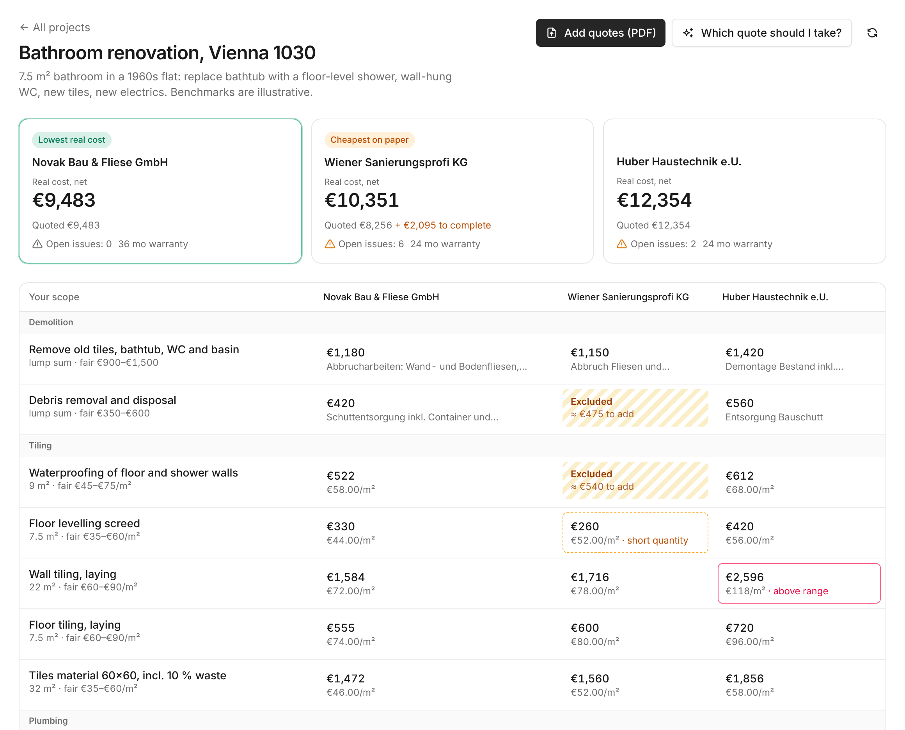

# Veridom Bids

**The cheapest renovation quote is often the most expensive one.** Contractors leave out waterproofing, debris removal or electrics, write "bauseits" (done by the owner) in small print, or quote fewer square metres than the job needs. A homeowner comparing three PDFs sees three totals and picks the lowest.

Veridom Bids lines every quote up against the owner's own scope, prices what each one leaves out, and shows the **real cost** of each contractor. The agent does the reading; the owner checks and corrects everything in the same table.



Built for the [Agent-Native Hackathon](https://www.builder.io/hackathon) (Builder.io, Oct 27 – Nov 9, 2026) as a new module of [Veridom](https://veridom.space), a house-building control app for private builders in Austria.

## What it does

1. **Upload the quotes.** PDFs are turned into text in the browser; only text is stored.
2. **The agent reads each quote** — usually German (Austria) — and records the header (net total, VAT, payment terms, warranty, dates) and every position, mapped to one of the owner's scope items. Words like *bauseits*, *nicht enthalten* and *Alternativposition* become "excluded" or "optional", not silently ignored.
3. **Deterministic checks run after every write**, no model involved:
   - required scope items that are missing or excluded, priced at the owner's fair range (or the other quotes' median),
   - quantities short of the scope,
   - unit prices outside the owner's range.
   The result is an **adjusted net** per contractor: quoted net + the cost of filling its gaps.
4. **The agent adds judgement the checks can't see**: a 50 % advance payment, open-ended hourly billing, a short warranty, a quote that expires in 14 days.
5. **The agent drafts questions** to each contractor in the language of their quote. The owner edits and approves them, then copies a ready letter or opens it in their email. Nothing is sent automatically.

In the demo bathroom, *Wiener Sanierungsprofi* is cheapest on paper (€8,256) but costs **€10,351** once debris removal, waterproofing, electrics and the missing screed are added. *Novak Bau* (€9,483, complete) is the real lowest.

## Why Agent-Native

The agent and the UI are the same app:

- **One action layer.** `record-quote-lines`, `update-quote-line`, `save-scope-items`, `raise-flag`, `save-questions` and the rest are single `defineAction` files. The agent calls them as tools; the table calls the same actions from React. A correction the owner makes in a cell is a `update-quote-line` call, marked `editedBy: user`, and a later re-extraction by the agent keeps it.
- **Shared data, shared state.** The price comparison refreshes after each agent tool call. The agent knows which project is on screen through `navigation.projectId`.
- **AI where it belongs.** Reading messy PDFs, mapping positions, judging terms and writing questions go through the agent chat. Totals, gap costs and flags are computed in plain code (`server/lib/bids.ts`), so a number on screen never comes from a model.
- **Buttons delegate to the agent** with `sendToAgentChat` ("Which quote should I take?", "Draft questions"), so every AI step is visible and steerable in the sidebar.

## Run it locally

Node 22.22+ and pnpm.

```bash
pnpm install
cp .env.example .env   # then set an LLM provider, see below
pnpm dev
```

Open the app, choose **Continue as local dev**, click **Try the demo bathroom**, and upload the three PDFs from [`demo/`](demo/). They are fictional quotes made for this demo (`demo/make_quotes.py` regenerates them).

LLM: any OpenAI-compatible endpoint works.

```
OPENAI_API_KEY=...
OPENAI_BASE_URL=https://cloud-api.near.ai/v1
AGENT_ENGINE=ai-sdk:openai
AGENT_MODEL=anthropic/claude-haiku-5-5
```

Deploy: `render.yaml` sets up a Render web service and Postgres database.

## What was built during the hackathon

The first commit is the unmodified Agent-Native **Chat** template (`npx @agent-native/core create --template chat`). Everything after it was written during the event:

- `server/db/*`, `server/plugins/db.ts` — schema and migrations (projects, scope items, quotes, lines, flags, questions)
- `server/lib/bids.ts` — access helpers and the deterministic comparison
- `actions/*` — 18 domain actions
- `app/routes/bids*.tsx`, `app/lib/pdf-text.ts` — the comparison UI and in-browser PDF text extraction
- `server/plugins/agent-chat.ts`, `AGENTS.md` — the agent's instructions
- English and German UI strings
- `demo/` — three fictional quotes

Benchmark ranges in the demo project are illustrative, not market data.

## License

MIT, see [LICENSE](LICENSE) (template license retained).
